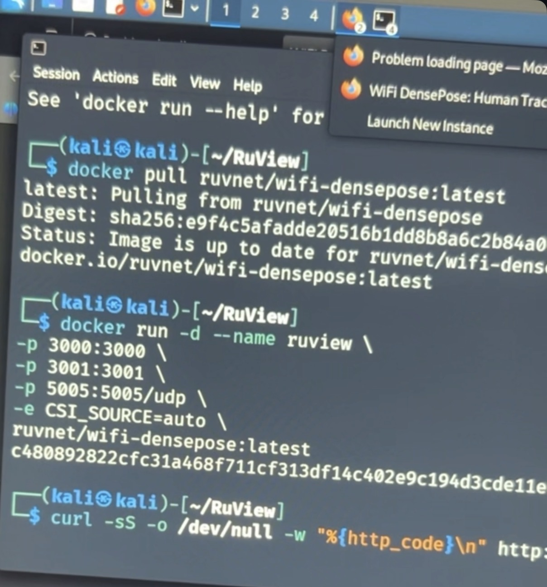
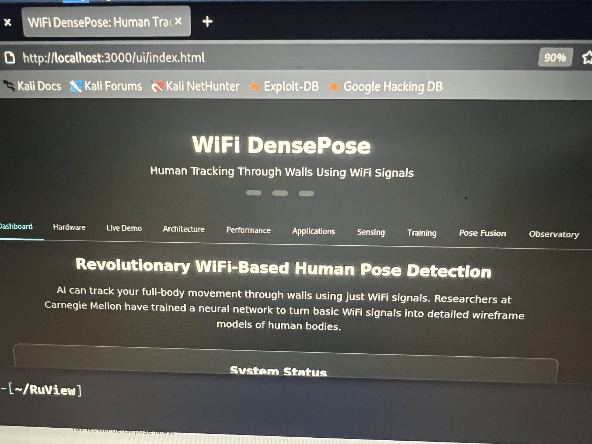
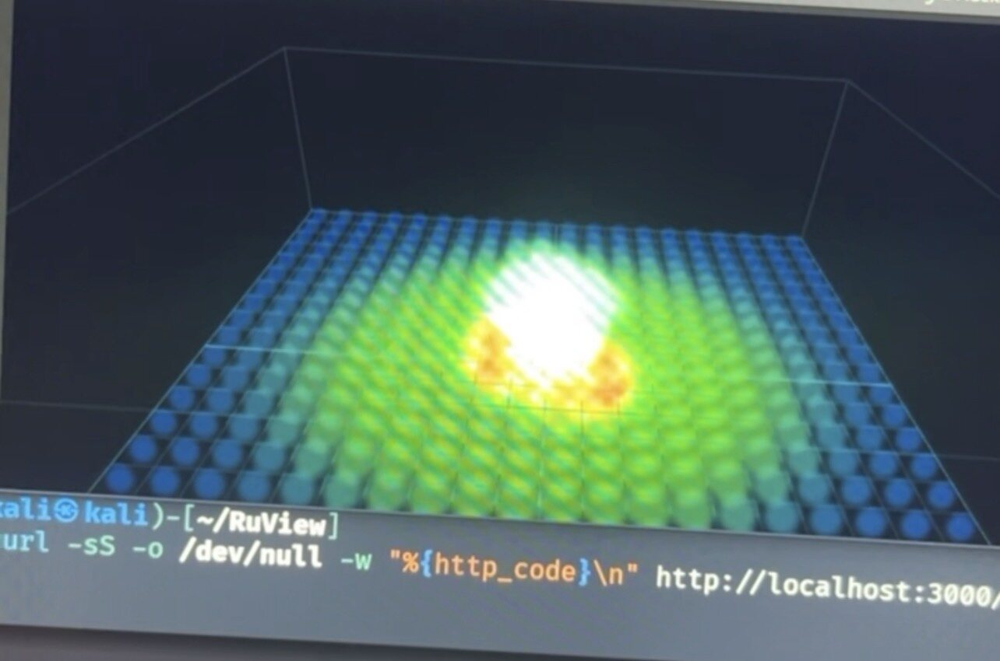
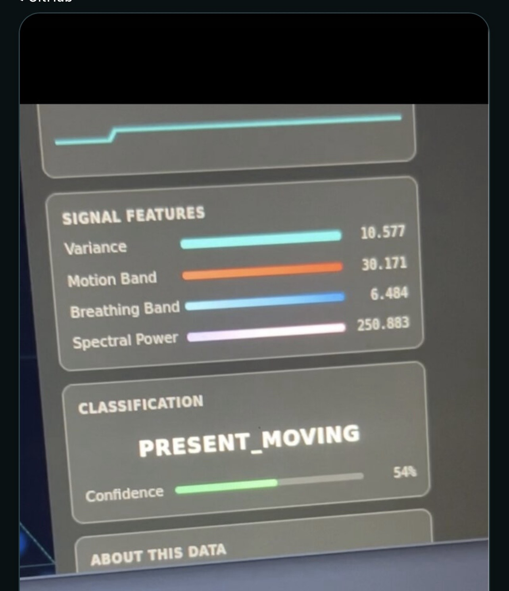

# WiFi CSI Telemetry Research Lab

**A Docker and wireless-sensing lab by Romando Wright.**

This repository documents my early RuView deployment on Kali Linux: container setup, local dashboard access, simulation output, and troubleshooting. It preserves the starting point for the broader AHSIN sensor and agent project.

[View the lab site](https://mandozone.github.io/WiFi-DensePose-Through-Wall-Human-Detection/) · [Lab notes](docs/LAB_NOTES.md) · [Evidence guide](docs/EVIDENCE.md)

## Scope and status

| Area | Recorded result |
| --- | --- |
| Environment | Kali Linux virtual machine with Docker |
| Deployment | Upstream RuView image pulled and a container started |
| Interface | Local dashboard and sensing visualizations displayed |
| Data source | Simulation is part of the captured early lab stage |
| Hardware and sensing | ESP32 integration continued as a separate development track |
| Through-wall accuracy and vital signs | Not validated by this repository's screenshots |

These are historical lab records, not a live service-health report. The repository name describes the research direction; it does not establish a working through-wall detection system.

## My contribution

- Configured and troubleshot the Kali/Docker environment.
- Investigated image startup, command formatting, DNS, and dashboard route issues.
- Documented the difference between infrastructure working and sensor data being validated.
- Recorded the early UI and deployment workflow, then continued broader integration work under AHSIN.

The sensing application is upstream software. This project does not claim authorship of RuView or an independently trained DensePose model.

## Selected photographs

### Container setup

The terminal shows the upstream image pull and a container identifier returned after launch. It does not show successful hardware ingestion. The photograph is a historical record, not a current deployment recipe; review binding and access controls before exposing any service.

### Local interface

This verifies that the interface was displayed. Promotional text inside the upstream UI is not a measured result from this lab.

### Simulation views

The heatmap, classification, and confidence display illustrate the interface during the early simulation stage. They do not independently demonstrate a real person's location, breathing, or movement.

## Lab workflow

| Step | What to establish |
| --- | --- |
| Environment | Correct VM networking, DNS, and Docker installation |
| Container | Expected image revision, running process, and intended port mapping |
| Web interface | Correct route and successful page load |
| Data source | Explicit simulation, recorded-input, or hardware mode |
| Hardware validation | Receiver-side data, payload decoding, identity, and freshness |
| Sensing validation | Controlled conditions, ground truth, and measured errors |

Read the [lab notes](docs/LAB_NOTES.md) before treating a screenshot as a result. A page loading and a container running are separate checks from a validated sensor pipeline.

## Relationship to AHSIN

[AHSIN](https://github.com/mandozone/ahsin) expands the work into sensor telemetry, operator dashboards, and permission-controlled AI tools. This repository stays focused on the early Wi-Fi/RuView lab; the broader manuals and agent-framework evidence belong in the separate AHSIN documentation repository.

## Privacy and attribution

Selected photographs were reviewed for visible private information and stripped of original metadata. Raw screenshot originals and address-bearing terminal images have been removed from the current tree. This does not remove files from earlier Git commits.

Experiments require authorization and participant consent. No medical or safety-critical claims are made.

Upstream image used in the recorded experiment: `ruvnet/wifi-densepose`. Third-party software and interface content remain subject to their respective licenses.

Documentation refreshed October 10, 2026.
